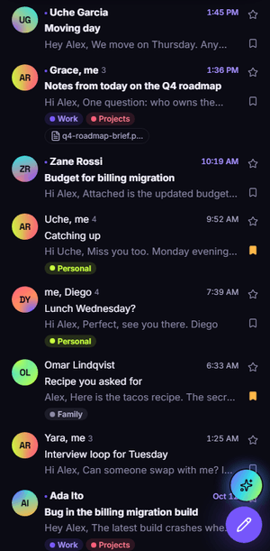
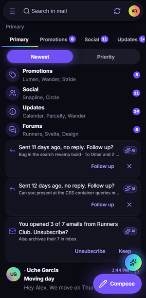
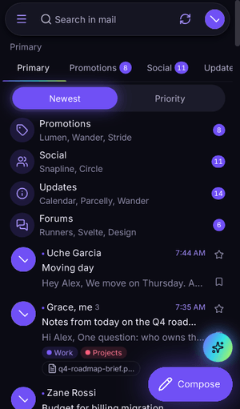
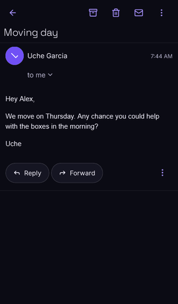
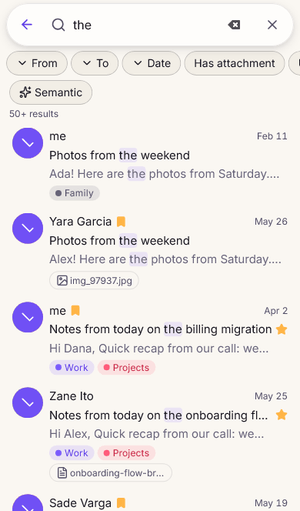
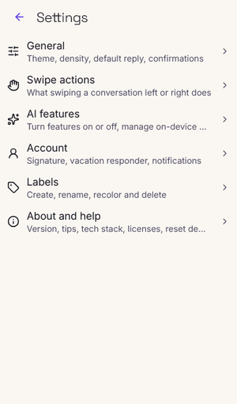
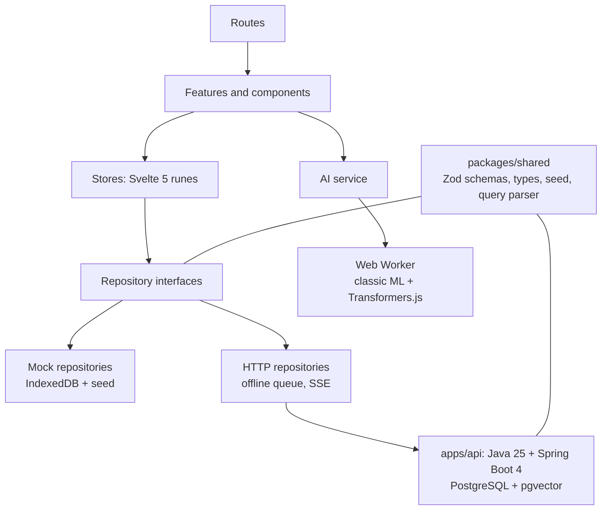

# Nem Mail

An AI-powered, Gmail-style mail app for phones, with its own visual identity called **Aurora Noir**. One SvelteKit codebase runs as a web demo, an installable PWA, and a Capacitor app for Android and iOS, backed by a Java 25 + Spring Boot 4 API. Its AI runs on the device and on the server, with no paid AI service, and the whole stack is live for $0 a month.

**Live demo:** [nem-mail.vercel.app](https://nem-mail.vercel.app). Tap **Try the demo**; no sign-up is needed. The free API sleeps when idle, so the first open can take up to a minute.

**API docs:** [Swagger UI](https://nem-mail-api.onrender.com/api/v1/swagger-ui.html)

<p>
  
  
  
</p>

<details>
<summary>Full 35-second walkthrough</summary>
<p></p>
</details>

Case study: [docs/case-study.md](docs/case-study.md) · Architecture: [docs/architecture.md](docs/architecture.md) · Security review and load test: [docs/security-review.md](docs/security-review.md)

> v2.0 is the full stack: the app talks to the real API, with realtime updates over SSE and an offline action queue. Without `PUBLIC_API_URL` it still runs on its built-in mock backend.

## Features

**Mail**

- Real accounts (sign up and sign in) plus a one-tap demo, with new mail pushed live over Server-Sent Events.

- Inbox categories (Primary, Promotions, Social, Updates, Forums) with category bundles and unread counts.
- Swipe to archive, delete, snooze or mark read (configurable), long press for multi-select with bulk actions, and Undo on every destructive action.
- Threads with collapsed older messages, safe HTML email (DOMPurify), attachments, and Gmail keys in a thread (`j` / `k` older and newer, `e` archive, `#` trash, `r` reply).
- Compose as a bottom sheet: chips for recipients with contact autocomplete, attachments, autosaved drafts, undo send, and schedule send.
- Labels (nested one level), snooze with a wake-up engine, stars, important, mute, and spam reporting.
- Search with Gmail operators (`from:`, `to:`, `subject:`, `has:attachment`, `is:unread`, `label:`, `before:`, `after:`), filter chips, highlights and recent searches.
- Two accounts on one device, a drawer for every mailbox and label, and a two-pane reading view on wide screens.

**On-device AI** (each one has a non-AI fallback, a Settings toggle and an "AI" badge)

| Feature                                      | How it works                                                 |
| -------------------------------------------- | ------------------------------------------------------------ |
| Smart categories                             | Naive Bayes plus rules; optional zero-shot MobileBERT MNLI   |
| Spam and phishing detection, with "why"      | Naive Bayes written from scratch; link and domain checks     |
| Thread summary and action items              | TextRank (extractive); optional DistilBART CNN               |
| Smart replies                                | Intent detection plus templates                              |
| Smart compose (ghost text)                   | N-gram language model trained on your sent mail              |
| Priority inbox                               | Logistic regression on sender and engagement features        |
| Semantic search                              | Optional MiniLM L6 v2 sentence embeddings, cosine similarity |
| Tone check before sending                    | Lexicon rules; optional DistilBERT SST-2                     |
| Follow-up nudges and unsubscribe suggestions | Rules over sent mail and open rates                          |
| Smart extraction                             | Codes, tracking numbers and dates as action chips            |
| AI assistant sheet                           | "Summarize unread", "What needs a reply?", "Draft reply"     |

Models run in a Web Worker, so scrolling and typing never wait for them. The optional transformer models are free, Apache-2.0, and downloaded only when you turn them on. On the server the classic models retrain per user from their feedback, and search ranks full text and pgvector similarity together.

**App feel**

- Aurora Noir design system: hand-made tokens, dark and light themes, fluid motion, reduced-motion and low-power modes.
- PWA with an offline service worker and iOS home-screen support (icons, splash screens, safe areas).
- Accessible: WCAG 2.2 AA checked with axe in both themes, keyboard support, focus traps, and a tap alternative for every gesture.

<p>
  
  
  
  
</p>

## Architecture



- **Repository pattern.** UI and stores only see interfaces in `data/repositories.ts`. `PUBLIC_DATA_SOURCE` picks the mock or the HTTP implementation. A lint rule blocks imports of a concrete backend outside `src/lib/data`.
- **Shared contracts.** Zod schemas in `packages/shared` define every request, response and error. The mock validates against them, the API mirrors them as Java records, and CI checks both sides against recorded API responses.
- **Mock backend.** Seeded mail in IndexedDB with simulated latency, errors, new arrivals, send delays and snooze wake-ups.

More detail: [docs/architecture.md](docs/architecture.md) (deployment, API and AI diagrams) and [docs/frontend.md](docs/frontend.md).

## Tech stack

| Layer        | Tech                                                   |
| ------------ | ------------------------------------------------------ |
| Web + mobile | SvelteKit 3, Svelte 5 (runes), TypeScript strict       |
| Native shell | Ionic core (`@ionic/core`) + Capacitor 8               |
| Styling      | Aurora Noir tokens, vanilla CSS                        |
| Data         | Zod contracts, IndexedDB (`idb`) mock backend          |
| ML           | Hand-written classic ML + Transformers.js, Comlink     |
| Tests        | Vitest + Testing Library, Playwright + axe             |
| Backend      | Java 25 + Spring Boot 4, PostgreSQL + pgvector, Flyway |
| API docs     | springdoc OpenAPI + Swagger UI                         |
| Hosting      | Vercel (web), Render (API), Neon (Postgres), all free  |

## Repository layout

```
apps/mobile      SvelteKit SPA: web demo, PWA and Capacitor app (android/, ios/)
apps/api         Java 25 + Spring Boot 4 API (Gradle, Docker, Flyway)
packages/shared  Zod schemas, types, seed generator, search query parser
docs/            Case study, architecture, security review, frontend and iOS guides
```

## Getting started

Requires Node 22+.

```bash
npm install
npm run dev          # http://localhost:5173
```

| Command            | What it does                                          |
| ------------------ | ----------------------------------------------------- |
| `npm run lint`     | Prettier check and ESLint                             |
| `npm run check`    | svelte-check (types)                                  |
| `npm run test`     | Unit and component tests (Vitest)                     |
| `npm run build`    | Static SPA build into `apps/mobile/build`             |
| `npm run test:e2e` | Playwright on iPhone 14 (WebKit) and Pixel 7 (Chrome) |

Settings live in `apps/mobile/.env` (copy `.env.example`). Every variable is public; the defaults run the mock backend.

To run the API too (needs JDK 25 and Docker), start Postgres and Mailpit, then the API, and set `PUBLIC_API_URL=http://localhost:8080/api/v1` in `apps/mobile/.env`:

```bash
cd apps/api
docker compose up -d
./gradlew bootRun --args='--spring.profiles.active=local,demo'
```

## Viewing on an iPhone

1. Open [nem-mail.vercel.app](https://nem-mail.vercel.app) in **Safari**.
2. Tap **Share**, then **Add to Home Screen**, then **Add**.
3. Open Nem Mail from the home screen. It runs full screen with its own icon and splash, and works offline after the first visit.

A native iOS build needs a Mac with Xcode (or a cloud Mac). See [docs/ios.md](docs/ios.md).

## Running on Android

The native apps wrap the same static build (app ID `com.onahstephen.nemmail`). Install [Android Studio](https://developer.android.com/studio), which includes the JDK and Android SDK, then from `apps/mobile`:

```bash
npm run cap:sync     # build the SPA and copy it into the native projects
npm run cap:android  # open the Android project in Android Studio
```

Run it from Android Studio or with `npx cap run android`. On Android Chrome you can also use **Install app** from the browser menu.

No Android tooling? The [Android build](.github/workflows/android.yml) workflow builds a debug APK on every change to the native project and launches it on an emulator. Download `nem-mail-debug-apk` from the latest run on the Actions tab and install it on a phone (allow installs from unknown sources).

## License

MIT © Onah Stephen
