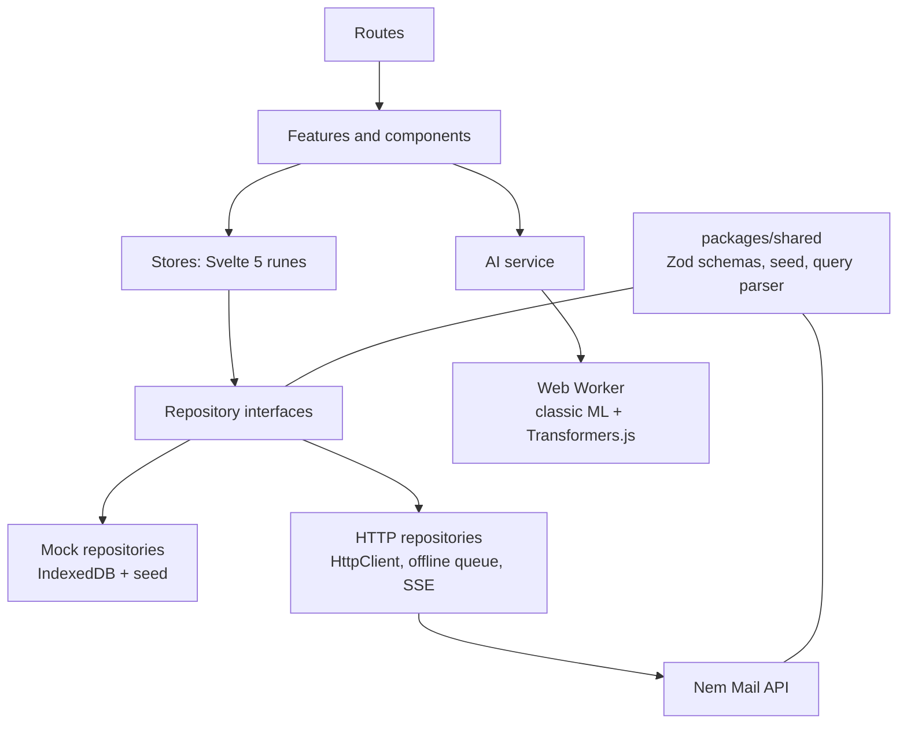
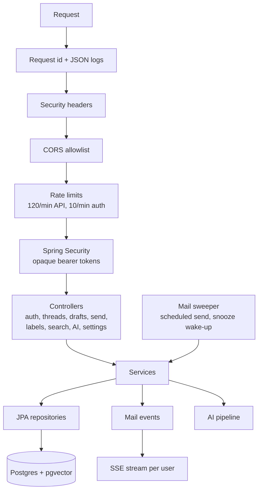
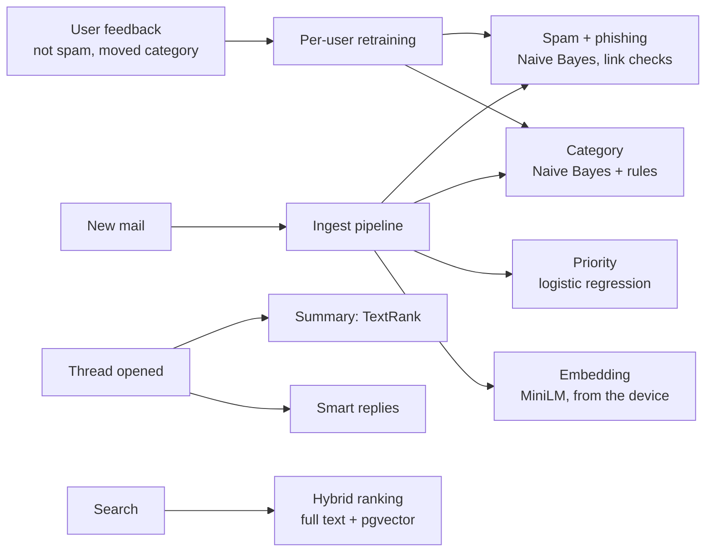

# Architecture

Nem Mail is one SvelteKit app (web, PWA, Android and iOS through Capacitor) and one Java API. They share their contracts through `packages/shared`. Everything runs on free tiers.

## Deployment

```mermaid
flowchart LR
    subgraph Clients
        W[Browser / PWA<br/>nem-mail.vercel.app]
        N[Android and iOS<br/>Capacitor shells]
    end
    V[Vercel<br/>static SvelteKit build]
    subgraph Render free, Frankfurt
        API[nem-mail-api<br/>Java 25 + Spring Boot 4<br/>Docker, 512 MB]
    end
    DB[(Neon Postgres 18<br/>pgvector, Frankfurt)]
    GH[GitHub Actions<br/>CI, Flyway migrate,<br/>keep-warm, nightly demo reset]

    W -- loads app --> V
    W -- REST + SSE, bearer token --> API
    N -- REST + SSE, bearer token --> API
    API -- JDBC over TLS --> DB
    GH -- flyway migrate --> DB
    GH -- /health every 10 min,<br/>POST /admin/demo/reset nightly --> API
```

- **Web** is a static SPA on Vercel. `PUBLIC_API_URL` points it at the API; without it the app runs on its built-in mock backend.
- **API** is a Docker image on Render's free web service, tuned for 512 MB (SerialGC, C1 only, `MaxRAMPercentage=70`). A free instance sleeps after 15 minutes idle, so a GitHub Actions job pings `/health` every 10 minutes and the app shows "Waking up the server…" on a cold start, with an offline demo as the way out.
- **Database** is Neon's free Postgres with pgvector. Flyway migrations run from CI on every schema change, and the API checks them again at boot.

## Frontend layers



UI code only sees the repository interfaces, and a lint rule blocks it from importing a concrete backend. Switching from the mock to the real API was a configuration change with no component edits. The HTTP layer adds typed errors, retries, an offline action queue that replays when the network returns, and an SSE stream that feeds new mail into the stores.

## API inside



- **Auth:** Argon2id password hashes; sessions are 32 random bytes and only their SHA-256 is stored.
- **Mail model:** a thread has messages; each user sees a thread through their own mailbox entries (inbox, sent, archive, trash, labels, read state), so one message delivered to two users is one row with two views.
- **Delivery:** send goes through an Outbox with undo; a sweeper delivers due and scheduled mail and wakes snoozed threads.
- **Contracts:** the API writes sample responses to `packages/shared/fixtures/api`, and Vitest parses them with the app's Zod schemas. `OpenApiContractTest` checks that the springdoc spec covers every endpoint the app calls.

## AI pipeline



Every model is small and free: classic methods written from scratch, trained per user from their own feedback, and evaluated in JUnit (spam accuracy at least 90%, category at least 80%). Heavier transformer models stay on the device, where the user opts in. The server never calls a paid AI service.

## API docs

Swagger UI: [nem-mail-api.onrender.com/api/v1/swagger-ui.html](https://nem-mail-api.onrender.com/api/v1/swagger-ui.html). Sign in with `POST /auth/signin` and the demo account (`alex@nemmail.example` / `demo-account`), copy the token, and press **Authorize**. The raw spec is at `/api/v1/v3/api-docs`.

Security review and load test results: [security-review.md](security-review.md).
