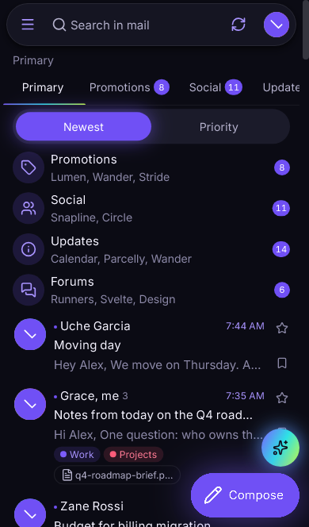
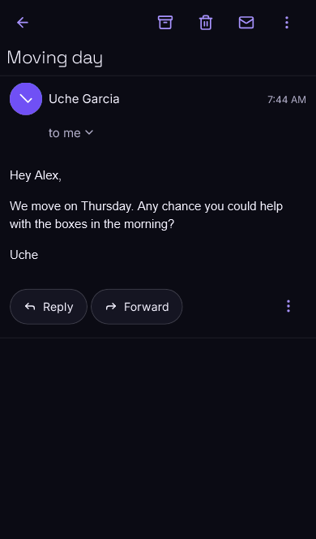
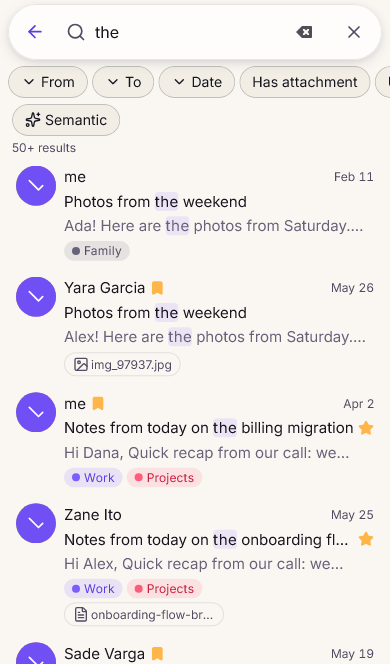
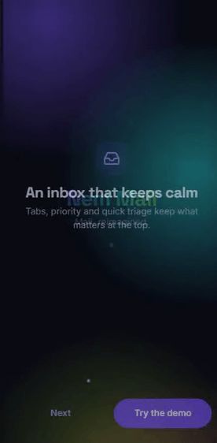

# Case study: Nem Mail

> A Gmail-class mail app for phones with its own design and AI, built as a portfolio piece by Onah Stephen. v2.0: full stack, live, $0 a month.
> Live demo: [nem-mail.vercel.app](https://nem-mail.vercel.app) · API docs: [Swagger UI](https://nem-mail-api.onrender.com/api/v1/swagger-ui.html) · Code: [github.com/onielsteve2003/nem-mail](https://github.com/onielsteve2003/nem-mail)

  
  
  

Walkthrough (35 s, Pixel 7 size):

## The brief

Rebuild the everyday mail app most people use, to a standard where a visitor opening the link for two minutes feels the polish: smooth gestures, fast lists, and AI that helps without getting in the way. Two hard rules:

- **Free only.** No paid APIs, no paid hosting, no AI service bills.
- **Phone first.** The owner tests on an iPhone from a Windows PC, so the web build has to feel native in Safari and as a home-screen app.

Phase 1 was the full frontend against a mock backend. Phase 2 added a real API (Java 25 + Spring Boot 4) and switched the app over to it without changing a single component.

## What I built (Phase 1: the app)

- **Mail you can triage with your thumb.** Category tabs, swipe actions with a magnet and fling, long-press multi-select, Undo on everything destructive, snooze, labels, stars.
- **Threads and compose.** Collapsed older messages, sanitized HTML email, a bottom-sheet composer with recipient chips, autosaved drafts, undo send and scheduled send.
- **Search.** Gmail operators (`from:`, `has:attachment`, `before:` …), filter chips, highlighted matches and recent searches.
- **Eleven on-device AI features.** Categories, spam with an explanation, summaries, smart replies, ghost-text compose, priority inbox, semantic search, tone check, nudges, extraction chips and an assistant sheet.
- **Aurora Noir**, a design system of my own: tokens, dark and light themes, motion presets, reduced-motion and low-power modes.
- **One codebase, four targets.** Web demo, installable PWA with offline support, an Android app and an iOS project, through Capacitor.

## Key decisions

**A repository layer between the UI and the data.** Screens and stores talk only to repository interfaces. In Phase 1 those are backed by a seeded IndexedDB "mock server" with realistic latency and live arrivals; in Phase 2 an HTTP implementation slots in. A lint rule fails the build if UI code reaches past the boundary, so the swap stays a config change.

**AI on the device, small models first.** Every feature starts with a classic method that is tiny and instant (Naive Bayes written from scratch, TextRank, an n-gram model, logistic regression, rules). Transformer models (MobileBERT, DistilBART, MiniLM, DistilBERT) are optional downloads the user turns on in Settings. Everything runs in a Web Worker, so scrolling and typing never wait on inference, and no mail content leaves the phone. Each feature has a non-AI fallback, a toggle and an "AI" badge.

**Native feel on the web.** iPhone Safari is the main target, so the work went into details: 16 px fields so focus never zooms, safe areas, no rubber-band on the shell, standalone detection, a status bar that follows the theme, haptics where the platform has them, and a service worker that boots the app offline.

**Performance budget.** Compose, the assistant and the two-pane reader load on idle, the list virtualizes above 200 rows, and fonts are subset. First-route JavaScript for the inbox is 189 KB gzipped (budget 200). Lighthouse mobile on the live site: Performance 92, Accessibility 100, Best Practices 100.

## Phase 2: the backend

- **A real mail server in Java.** Java 25 and Spring Boot 4 on virtual threads, with Postgres and pgvector. Accounts, threads, drafts, send with undo, scheduled send, snooze, labels, attachments, contacts, settings and search, all behind the same Zod contracts the app already used.
- **Realtime.** Server-Sent Events push new mail, read state and moves to every open device; the app shows a toast and updates the list in place.
- **AI on the server too.** The classic models were ported to Java and now retrain per user from their own feedback ("not spam", moving a mail to another tab). Search ranks full text and pgvector similarity together, using embeddings the phone already computes, so the 512 MB server never loads a transformer.
- **Works badly connected.** An offline queue keeps archive, delete, label and draft actions while the network is gone and replays them in order when it returns.
- **Free hosting that feels awake.** Render's free instance sleeps; a GitHub Actions ping keeps it warm, and on a cold start the app says "Waking up the server…" and offers the offline demo after 20 seconds.

**One contract, two languages.** The API writes its real responses to fixtures that Vitest parses with the app's Zod schemas, and a JUnit test checks that the OpenAPI spec covers every endpoint the app calls. If the Java and TypeScript sides drift, CI fails before a user sees it.

## Quality

- **End to end:** 36 Playwright tests cover the seven core flows (onboarding, triage, read, reply, compose, search, navigate) on an iPhone 14 (WebKit) and a Pixel 7 (Chromium).
- **Visual regression:** 20 baselines of five key screens in both themes on both phones, made deterministic by freezing the clock and hiding AI output that arrives in any order.
- **Accessibility:** axe checks (WCAG 2.2 AA) of the main screens in both themes, focus traps on sheets, and a tap alternative for every gesture.
- **Native builds in CI:** GitHub Actions builds the Android APK and launches it on an emulator, and compiles the iOS project on a cloud Mac.
- **Backend:** JUnit and Testcontainers against real Postgres for every endpoint, model accuracy gates (spam at least 90%, category at least 80%), and the full Playwright suite run against the local API.
- **Security:** an OWASP Top 10 review of the live API ([security-review.md](security-review.md)). It found that rate limiting did nothing behind Render's Cloudflare edge, since each request came from a different edge IP; the limiter now keys on the client IP Cloudflare reports.
- **Manual pass** on a real iPhone (Safari and home-screen app), Android Chrome and desktop.

## Hard parts

- **Gestures that don't fight scrolling.** Swipe rows lock to an axis only after 10 px with a 1.5× ratio and capture the pointer only then, so vertical scrolling stays native and a swipe never fires a tap.
- **Deterministic screenshots of a living inbox.** The mock server generates mail relative to "now" and keeps sending new mail; visual tests pin the clock so the seed and the arrivals are frozen.
- **Spring Boot in 512 MB.** The JVM runs with SerialGC, the C1 compiler only and a capped heap, and boots in about 20 seconds at Render's CPU share. I tried Java 25's AOT cache to cut that; it would not load at that memory size, so I kept the keep-warm ping instead of risking a boot failure.
- **iOS without a Mac.** The iOS project is generated and checked on Windows, then compiled on a GitHub-hosted Mac; the day-to-day iPhone path is the PWA.

## Results

- Live full stack at $0 a month: Vercel, Render, Neon and GitHub Actions free tiers.
- Load test on the free API: 100 requests at concurrency 10, all succeeded, p50 699 ms and p95 1.5 s on a tenth of a CPU.
- Lighthouse mobile: Performance 92, Accessibility 100, Best Practices 100.

Architecture diagrams: [architecture.md](architecture.md).
